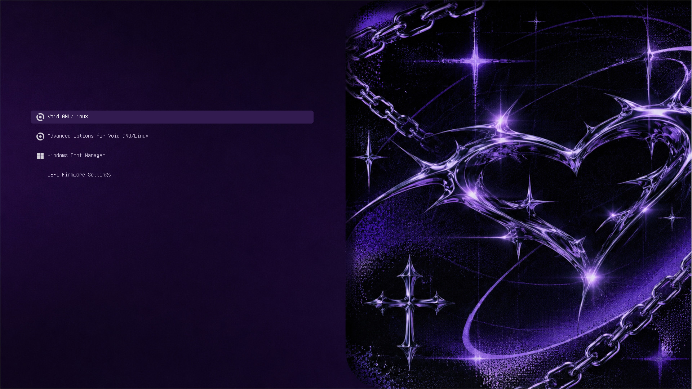

# gothic-y2k-grub-theme

<p align="center">
  
  
  <a href="https://finance.ozon.ru/apps/sbp/ozonbankpay/01a1ba9f-6038-7661-a5ed-99a840ca52cc">
    
  </a>
</p>

<p align="center">
  
  <br>
  <sub>Preview of GRUB</sub>
</p>

## Installation

### 1. Clone the repository

```bash
git clone https://github.com/KestelG/gothic-y2k-grub-theme.git
cd gothic-y2k-grub-theme
```

### 2. Copy the theme

Create the GRUB themes directory if it doesn't exist:

```bash
sudo mkdir -p /boot/grub/themes
```

Copy the theme:

```bash
sudo cp -r gothic-y2k-grub-theme /boot/grub/themes/
```

### 3. Configure GRUB

Open the GRUB configuration file:

```bash
sudo nano /etc/default/grub
```

Find or add the following line:

```bash
GRUB_THEME="/boot/grub/themes/gothic-y2k-grub-theme/theme.txt"
```

Make sure the line is not commented out.

### 4. Regenerate GRUB configuration

**Void Linux / Debian / Ubuntu:**

```bash
sudo grub-mkconfig -o /boot/grub/grub.cfg
```

**Fedora:**

```bash
sudo grub2-mkconfig -o /boot/grub2/grub.cfg
```

### 5. Reboot

```bash
sudo reboot
```

Enjoy your new bootloader!

## Support the project

If you enjoy this theme and want to support its development, consider making a donation.

<p align="center">
  <a href="https://finance.ozon.ru/apps/sbp/ozonbankpay/01a1ba9f-6038-7661-a5ed-99a840ca52cc">
    
  </a>
</p>

Every contribution helps keep the project alive and motivates further development.

## Contributing

Contributions, suggestions and bug reports are welcome!

Feel free to open an issue or submit a pull request.

## License

This project is distributed under the [LICENSE](LICENSE) license.
